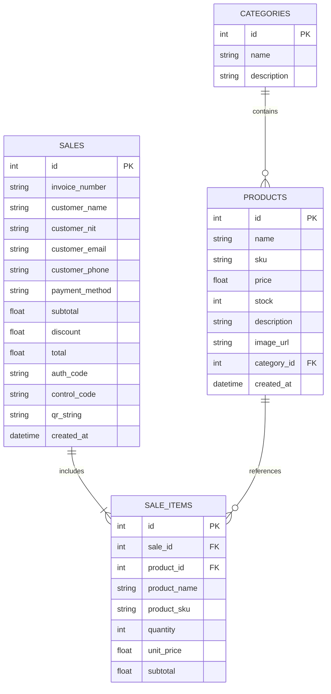

# 🚴 PEPEBIKE API · Backend FastAPI & Supabase PostgreSQL

API REST de alto rendimiento desarrollada con **FastAPI**, **SQLAlchemy** y **Supabase PostgreSQL**, diseñada para alimentar la tienda ciclista 3D interactiva **PEPEBIKE**, el sistema de punto de venta (POS) multi-artículo, la facturación computarizada oficial y el control de inventario en tiempo real.

[](https://fastapi.tiangolo.com)
[](https://www.python.org)
[](https://supabase.com)
[](https://proyecto-productos-backend.onrender.com/api/v1/products)

---

## 🌐 URLs de Producción y Documentación

* **Base URL en Render:** `https://proyecto-productos-backend.onrender.com`
* **Swagger UI Interactiva:** `https://proyecto-productos-backend.onrender.com/docs`
* **ReDoc:** `https://proyecto-productos-backend.onrender.com/redoc`
* **Frontend Oficial en Vercel:** `https://frontend-one-pied-80.vercel.app`

---

## 🚀 Características Principales

1. **Gestión de Catálogo e Inventario Ciclista:**
   * Soporte para Bicicletas de Montaña, Bicicletas de Ruta, E-Bikes, Cascos, Guantes, Gafas Deportivas y Candados de Seguridad.
   * Endpoints optimizados para actualización atómica de stock en vivo (`PATCH` y `PUT`).
   * Sincronización continua de inventario con PostgreSQL y prevención de sobreventa.

2. **Sistema de Ventas POS y Facturación Computarizada:**
   * Registro de ventas multi-ítem con desglose de cantidades, precios unitarios y subtotales.
   * Generación de comprobantes de venta oficiales con:
     * Número de factura correlativo autoincremental (`FAC-00000X`).
     * Razón Social y NIT / Carnet de Identidad del cliente.
     * Código de Autorización y Código de Control alfanumérico.
     * Cadena QR Oficial tributaria.
     * Métodos de pago admitidos: Efectivo, Tarjeta de Débito/Crédito y QR Simple.

3. **Arquitectura Robusta y Resiliente:**
   * Conexión a Supabase mediante **Supavisor Connection Pooler** (puerto 5432 / pool de conexiones transaccionales).
   * Migraciones y creación automática de tablas relacionales al iniciar la aplicación.
   * CORS configurado para admitir clientes locales (`localhost:5173`) y despliegues en producción en Vercel.

---

## 🗄️ Modelo Relacional de Base de Datos



---

## 📡 Endpoints de la API REST

### Productos (`/api/v1/products`)

| Método | Ruta | Descripción |
| :--- | :--- | :--- |
| `GET` | `/api/v1/products` | Obtiene el catálogo completo de productos con categoría y stock. |
| `GET` | `/api/v1/products/{id}` | Obtiene los detalles técnicos de un producto específico. |
| `POST` | `/api/v1/products` | Registra un nuevo producto en la base de datos Supabase. |
| `PATCH` | `/api/v1/products/{id}` | Actualiza exclusivamente el stock de un producto (`{"stock": 15}`). |
| `PUT` | `/api/v1/products/{id}` | Actualización completa de atributos del producto. |
| `DELETE`| `/api/v1/products/{id}` | Elimina un producto del catálogo. |

### Ventas y Facturación POS (`/api/v1/sales`)

| Método | Ruta | Descripción |
| :--- | :--- | :--- |
| `GET` | `/api/v1/sales` | Retorna el historial de ventas y facturas emitidas con sus ítems. |
| `GET` | `/api/v1/sales/{id}` | Obtiene el detalle completo y comprobante imprimible de una venta. |
| `POST` | `/api/v1/sales` | Procesa una venta multi-ítem, descuenta el stock y emite la factura oficial. |

### Categorías (`/api/v1/categories`)

| Método | Ruta | Descripción |
| :--- | :--- | :--- |
| `GET` | `/api/v1/categories` | Lista de familias y categorías de ciclismo. |

---

## 🛠️ Instalación y Ejecución Local

### 1. Clonar el repositorio
```bash
git clone https://github.com/PEPE456-PP/proyecto-productos-backend.git
cd proyecto-productos-backend
```

### 2. Crear y activar el entorno virtual
```bash
python3 -m venv venv
source venv/bin/activate  # En Linux / macOS
# o en Windows: venv\Scripts\activate
```

### 3. Instalar dependencias
```bash
pip install -r requirements.txt
```

### 4. Configurar variables de entorno
Crea tu archivo local `.env` a partir de `.env.example`:
```bash
cp .env.example .env
```

Configura tu cadena de conexión a PostgreSQL / Supabase:
```env
DATABASE_URL=postgresql+psycopg2://postgres.<PROJECT_REF>:<PASSWORD>@aws-0-us-east-1.pooler.supabase.com:5432/postgres
```

> ⚠️ **Importante:** Nunca compartas ni subas tu archivo `.env` a GitHub. Está explícitamente protegido en `.gitignore`.

### 5. Iniciar el servidor de desarrollo
```bash
uvicorn main:app --reload --host 0.0.0.0 --port 8000
```
La documentación interactiva estará disponible en: `http://localhost:8000/docs`

---

## ☁️ Despliegue en Render

El backend está configurado para despliegue automático mediante Git push:

1. **Build Command:** `pip install -r requirements.txt`
2. **Start Command:** `uvicorn main:app --host 0.0.0.0 --port $PORT`
3. **Environment Variable en Render:**
   * `DATABASE_URL`: Cadena segura hacia Supabase PostgreSQL.
   * `PYTHON_VERSION`: `3.12.0`

---

## 📄 Licencia

Este proyecto fue desarrollado con fines educativos y de actualización profesional para **UDABOL - Módulo 4**.
